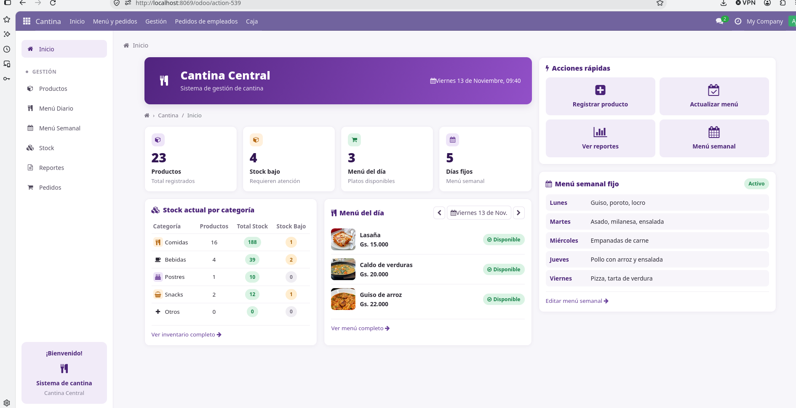
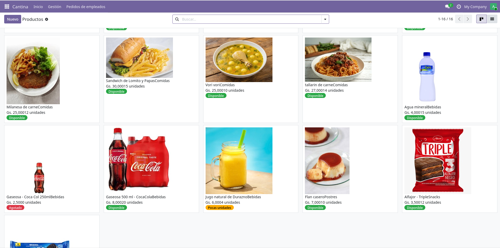
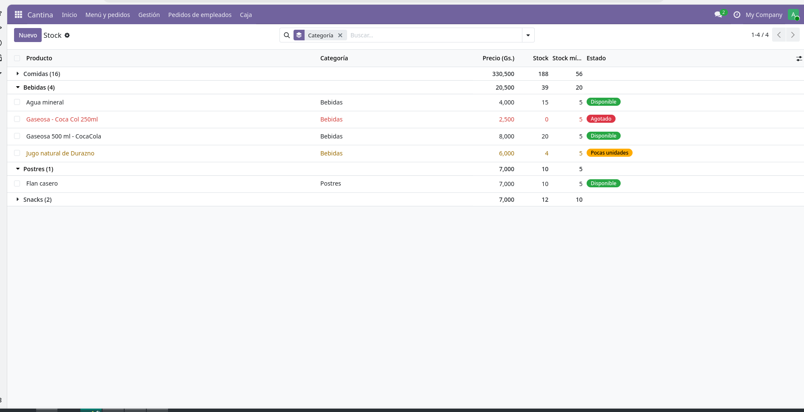
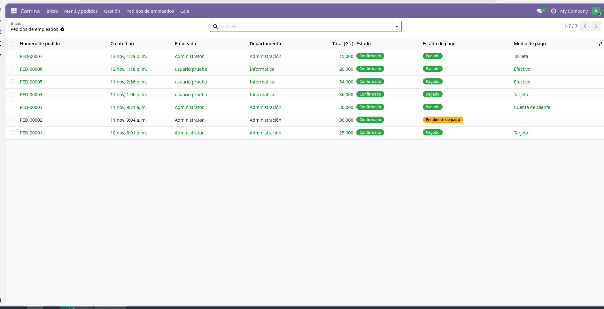
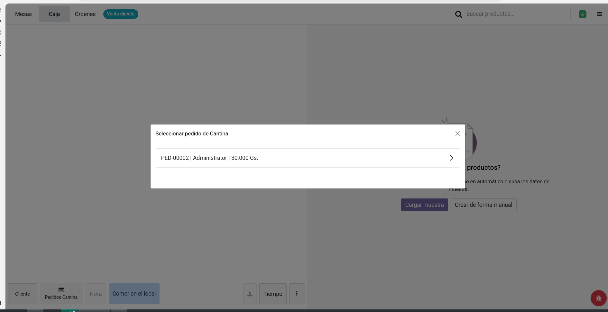
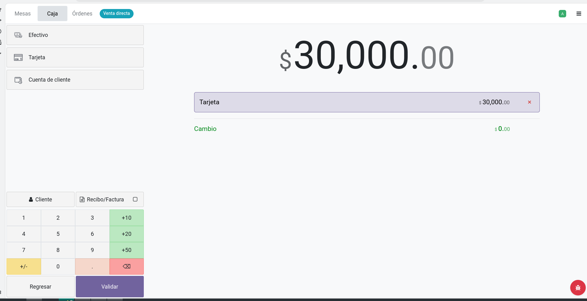

# Manual del Administrador
## Sistema de Gestión de Cantina

### 1. Introducción
El sistema permite administrar los productos, el stock, los menús y los pedidos de la cantina.

### 2. Usuarios
- **Administradora:** administra los productos, menús, stock, pedidos y configuración.
- **Empleado:** consulta productos y menús, y gestiona sus propios pedidos.

### 3. Panel principal
Muestra información general sobre el funcionamiento de la cantina.

### 4. Productos y stock
Permite crear, modificar y eliminar productos, asignar categorías, establecer precios y controlar las cantidades
disponibles.

### 5. Pedidos
Permite consultar los pedidos de los empleados, revisar sus detalles y controlar su estado.

### 6. Pagos
Permite consultar y gestionar los pagos relacionados con los pedidos.

### 7. Punto de Venta
Integra las operaciones de la cantina con el Punto de Venta de Odoo.

**Fin del manual del administrador.**