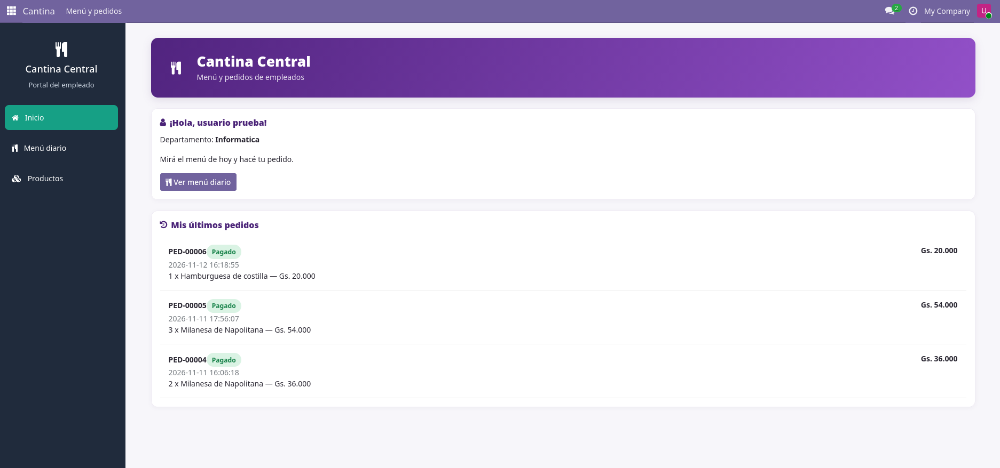
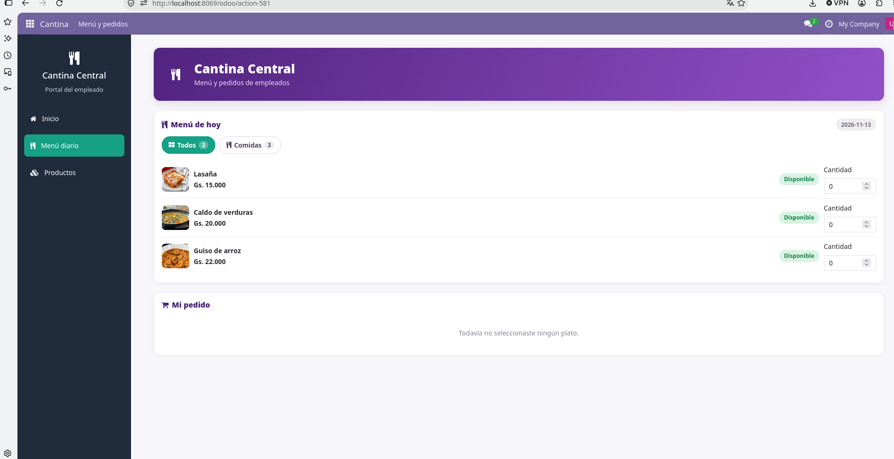
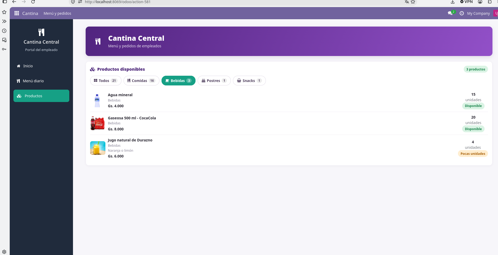

# Manual del Cliente
## Sistema de Gestión de Cantina

### 1. Inicio

Al ingresar al sistema, el cliente visualiza la pantalla principal de la cantina, desde donde puede acceder a las diferentes opciones de consulta.

### 2. Menú diario

En esta sección se pueden consultar las comidas disponibles para una fecha determinada.

El usuario puede visualizar los platos ofrecidos por la cantina y conocer las opciones disponibles para el día.

### 3. Productos disponibles

Esta sección permite consultar los productos registrados en la cantina.

El cliente puede visualizar:
- Nombre del producto.
- Categoría.
- Precio.
- Disponibilidad y stock.

El usuario solamente puede consultar la información.

**Fin del manual del cliente.**